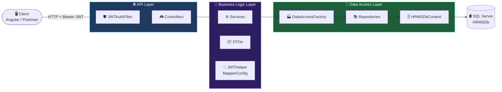
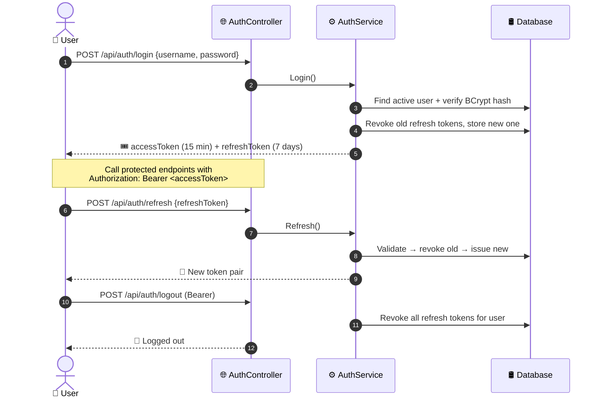
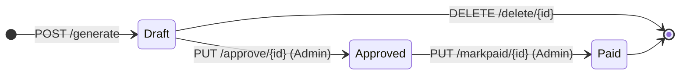
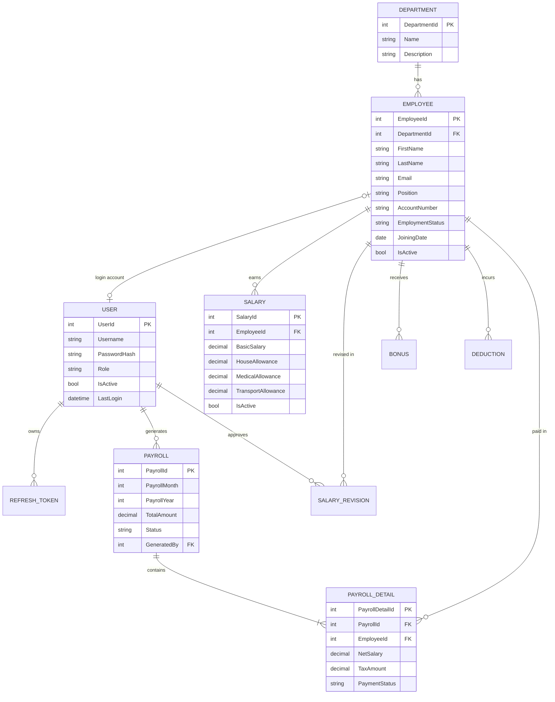

<!-- ═══════════════════════════ ANIMATED HEADER ═══════════════════════════ -->
<p align="center">
  
</p>

<p align="center">
  <a href="#-overview">
    
  </a>
</p>

<p align="center">
  
  
  
  
  
</p>

<p align="center">
  
  
  
  
</p>

<p align="center">
  <a href="#-overview">Overview</a> •
  <a href="#-key-features">Features</a> •
  <a href="#%EF%B8%8F-architecture">Architecture</a> •
  <a href="#-data-model">Data Model</a> •
  <a href="#-api-reference">API Reference</a> •
  <a href="#-getting-started">Getting Started</a> •
  <a href="#-usage-examples">Examples</a>
</p>


## 📖 Overview

**HRMS-API** is a role-based **Human Resource Management System** backend built with **ASP.NET Web API 2** on **.NET Framework 4.8**. It follows a clean **three-layer architecture** (API → BLL → DAL) and covers the everyday work of an HR department, from onboarding employees to generating, approving and paying monthly payroll.

> [!TIP]
> The API is ready for a SPA frontend. CORS is preconfigured for an Angular dev server on `http://localhost:4200`.

<table>
<tr>
<td width="50%" valign="top">

### 🎯 What it does
- Manages **departments** and **employees**
- Tracks **salaries**, **revisions**, **bonuses** and **deductions**
- **Generates payroll** per month with automatic tax calculation
- Moves payroll through a **Draft → Approved → Paid** lifecycle
- Secures everything with **JWT + rotating refresh tokens**

</td>
<td width="50%" valign="top">

### 🧰 Built with
- **ASP.NET Web API 2** (attribute routing)
- **Entity Framework 6** (code-first + migrations)
- **AutoMapper** (entity ⇄ DTO mapping)
- **BCrypt.Net-Next** (password hashing)
- **System.IdentityModel.Tokens.Jwt** (HMAC-SHA256)
- **Newtonsoft.Json**

</td>
</tr>
</table>


## ✨ Key Features

<table>
<tr>
<td align="center" width="25%">
  <br/>
  <b>Authentication</b><br/>
  <sub>Login, refresh-token rotation, logout with revocation, change password</sub>
</td>
<td align="center" width="25%">
  <br/>
  <b>Employee Management</b><br/>
  <sub>CRUD, keyword search, department filter, auto-created user accounts</sub>
</td>
<td align="center" width="25%">
  <br/>
  <b>Compensation</b><br/>
  <sub>Salaries with allowances, revision history, bonuses, deductions</sub>
</td>
<td align="center" width="25%">
  <br/>
  <b>Payroll Engine</b><br/>
  <sub>One-click monthly generation, tax brackets, approval workflow</sub>
</td>
</tr>
</table>

<details open>
<summary><b>🔐 Authentication & Security</b></summary>
<br/>

- 🔑 Username/password login, with passwords hashed using **BCrypt**
- ⏱️ Short-lived **JWT access tokens** (15 min by default, signed with HMAC-SHA256)
- ♻️ **Refresh token rotation**: each refresh revokes the old token and issues a new one (7 days by default)
- 🚪 **Logout** revokes every refresh token belonging to the user
- 🛡️ Custom `JWTAuthFilter` attribute that checks the header, signature, expiry and **role**
- 👮 Three roles: `Admin`, `HR`, `Employee`
- 🚫 Inactive users can't log in or refresh their tokens

</details>

<details>
<summary><b>👥 HR Management</b></summary>
<br/>

- 🏢 Departments with live employee counts
- 👤 Employees with contact, position, bank account, employment status and remarks
- 🔍 Keyword search and filtering by department
- 🤖 **Creating an employee also creates a login account** with the `Employee` role
- 📈 Salary revisions archive the previous salary and keep a full history

</details>

<details>
<summary><b>🧾 Payroll</b></summary>
<br/>

- 📅 Generates payroll for any `month/year` and blocks duplicates for the same period
- ➕ Gross = Basic + House + Medical + Transport allowances + bonuses for the month
- ➖ Net = Gross − deductions for the month − tax
- ⏭️ Skips employees with no active salary
- ✅ Only **Draft** payrolls can be approved or deleted, and only **Approved** payrolls can be marked paid
- 💸 Marking a payroll as paid sets every payroll detail line to `Paid`

</details>


## 🏛️ Architecture



<details>
<summary><b>📁 Project structure</b></summary>

```text
HRMS-API/
├── 🌐 API/                         → HTTP surface (ASP.NET Web API 2)
│   ├── App_Start/WebApiConfig.cs   → Attribute routing & formatters
│   ├── Controllers/                → Auth, User, Department, Employee,
│   │                                 Salary, Bonus, Deduction, Payroll
│   ├── Filters/JWTAuthFilter.cs    → Token + role authorization
│   └── Web.config                  → Connection string, JWT & CORS settings
│
├── 🧠 BLL/                         → Business rules
│   ├── DTOs/                       → Request/response contracts
│   ├── Helpers/JWTHelper.cs        → Token generation & validation
│   ├── Helpers/MapperConfig.cs     → AutoMapper profiles
│   └── Services/                   → AuthService, PayrollService, ...
│
├── 💾 DAL/                         → Persistence
│   ├── Models/                     → EF entities
│   ├── Models/Context/             → HRMSDbContext (Fluent API relations)
│   ├── Interfaces/                 → IRepo<T> + specialized repo contracts
│   ├── Repositories/               → EF implementations
│   ├── Migrations/                 → EF code-first migration history
│   └── DataAccessFactory.cs        → Repository factory
│
└── 📄 HRMS_API_Documentation.pdf
```

</details>

### 🔄 Authentication Flow



### 📊 Payroll Lifecycle



### 🧮 Tax Brackets

Tax is calculated on **gross salary** (basic + allowances + bonuses):

| Monthly Gross Salary | Tax Rate |
|:---|:---:|
| ≤ 20,000 | **0%** |
| 20,001 – 40,000 | **5%** |
| 40,001 – 80,000 | **10%** |
| > 80,000 | **15%** |

> **Net Salary** = Gross − Deductions (for the month) − Tax


## 🗂️ Data Model




## 📡 API Reference

> **Base URL:** `http://localhost:<port>/api`
> Protected endpoints require `Authorization: Bearer <access_token>`.

### 👮 Access Matrix

| Module | 🔓 Public | 🟢 Any signed-in user | 🟡 Admin, HR | 🔴 Admin only |
|:---|:---:|:---:|:---:|:---:|
| Auth: login / refresh | ✅ | | | |
| Auth: logout / change-password | | ✅ | | |
| Auth: assign-role | | | | ✅ |
| Users | | | | ✅ |
| Departments · Employees · Salaries | | | ✅ | |
| Bonuses · Deductions | | | ✅ | |
| Payroll (view / generate / delete) | | | ✅ | |
| Payroll: approve / mark paid | | | | ✅ |

<details>
<summary><b>🔐 Auth</b> · <code>/api/auth</code></summary>

| Method | Endpoint | Access | Description |
|:---:|:---|:---:|:---|
|  | `/login` | Public | Log in and receive a token pair |
|  | `/refresh` | Public | Swap a refresh token for a new pair |
|  | `/logout` | Signed in | Revoke all refresh tokens |
|  | `/change-password` | Signed in | Change password (min 6 chars) |
|  | `/assign-role` | Admin | Set a user's role |

</details>

<details>
<summary><b>👤 Users</b> · <code>/api/user</code></summary>

| Method | Endpoint | Access | Description |
|:---:|:---|:---:|:---|
|  | `/all` | Admin | List all users |
|  | `/{id}` | Admin | Get a user by ID |
|  | `/by-username/{username}` | Admin | Get a user by username |
|  | `/toggle-active/{id}` | Admin | Activate or deactivate a user |

</details>

<details>
<summary><b>🏢 Departments</b> · <code>/api/department</code></summary>

| Method | Endpoint | Access | Description |
|:---:|:---|:---:|:---|
|  | `/all` | Admin, HR | List departments |
|  | `/{id}` | Admin, HR | Get a department |
|  | `/create` | Admin, HR | Create a department |
|  | `/update` | Admin, HR | Update a department |
|  | `/delete/{id}` | Admin, HR | Delete a department |

</details>

<details>
<summary><b>👥 Employees</b> · <code>/api/employee</code></summary>

| Method | Endpoint | Access | Description |
|:---:|:---|:---:|:---|
|  | `/all` | Admin, HR | List employees |
|  | `/{id}` | Admin, HR | Get an employee |
|  | `/search?keyword=` | Admin, HR | Search by keyword |
|  | `/filter/department/{departmentId}` | Admin, HR | Filter by department |
|  | `/create` | Admin, HR | Create an employee and their login account |
|  | `/update` | Admin, HR | Update an employee |
|  | `/delete/{id}` | Admin, HR | Delete an employee |

</details>

<details>
<summary><b>💵 Salaries</b> · <code>/api/salary</code></summary>

| Method | Endpoint | Access | Description |
|:---:|:---|:---:|:---|
|  | `/all` | Admin, HR | List salaries |
|  | `/{id}` | Admin, HR | Get a salary record |
|  | `/employee/{employeeId}` | Admin, HR | Get an employee's active salary |
|  | `/revisions/{employeeId}` | Admin, HR | Get revision history |
|  | `/create` | Admin, HR | Create a salary |
|  | `/update` | Admin, HR | Update a salary |
|  | `/revise` | Admin, HR | Revise a salary (archives the old one) |
|  | `/delete/{id}` | Admin, HR | Delete a salary |

</details>

<details>
<summary><b>🎁 Bonuses</b> · <code>/api/bonus</code></summary>

| Method | Endpoint | Access | Description |
|:---:|:---|:---:|:---|
|  | `/all` | Admin, HR | List bonuses |
|  | `/{id}` | Admin, HR | Get a bonus |
|  | `/employee/{employeeId}` | Admin, HR | List an employee's bonuses |
|  | `/create` | Admin, HR | Create a bonus |
|  | `/update` | Admin, HR | Update a bonus |
|  | `/delete/{id}` | Admin, HR | Delete a bonus |

</details>

<details>
<summary><b>➖ Deductions</b> · <code>/api/deduction</code></summary>

| Method | Endpoint | Access | Description |
|:---:|:---|:---:|:---|
|  | `/all` | Admin, HR | List deductions |
|  | `/{id}` | Admin, HR | Get a deduction |
|  | `/employee/{employeeId}` | Admin, HR | List an employee's deductions |
|  | `/employee/{employeeId}/{month}/{year}` | Admin, HR | Deductions for one period |
|  | `/create` | Admin, HR | Create a deduction |
|  | `/update` | Admin, HR | Update a deduction |
|  | `/delete/{id}` | Admin, HR | Delete a deduction |

</details>

<details>
<summary><b>🧾 Payroll</b> · <code>/api/payroll</code></summary>

| Method | Endpoint | Access | Description |
|:---:|:---|:---:|:---|
|  | `/all` | Admin, HR | List payrolls |
|  | `/{id}` | Admin, HR | Payroll summary |
|  | `/{id}/details` | Admin, HR | Per-employee breakdown |
|  | `/generate` | Admin, HR | Generate payroll for a month |
|  | `/approve/{id}` | **Admin** | Draft → Approved |
|  | `/markpaid/{id}` | **Admin** | Approved → Paid |
|  | `/delete/{id}` | Admin, HR | Delete a Draft payroll |

</details>


## 🚀 Getting Started

### ✅ Prerequisites

| Tool | Version |
|:---|:---|
| 🟣 Visual Studio | 2022 / 2026 (with the *ASP.NET and web development* workload) |
| ⚙️ .NET Framework Developer Pack | 4.8 |
| 🛢️ SQL Server | Express, LocalDB or full edition |
| 📦 NuGet | Package restore enabled |

### 🛠️ Installation

```bash
# 1️⃣ Clone the repository
git clone https://github.com/ahasan-ullah/HRMS-API.git
cd HRMS-API

# 2️⃣ Open the solution in Visual Studio
start HRMS.slnx
```

**3️⃣ Configure the database** in `API/Web.config`:

```xml
<connectionStrings>
  <add name="HRMSDbContext"
       connectionString="data source=YOUR_SERVER\SQLEXPRESS; initial catalog=HRMSDb; integrated security=true;"
       providerName="System.Data.SqlClient" />
</connectionStrings>
```

**4️⃣ Configure JWT settings** in `API/Web.config` → `<appSettings>`:

| Key | Default | Purpose |
|:---|:---:|:---|
| `JwtSecretKey` | *(base64 key)* | HMAC-SHA256 signing key |
| `JwtIssuer` | `HRMS` | Token issuer |
| `JwtAudience` | `HRMS` | Token audience |
| `JwtAccessTokenMins` | `15` | Access token lifetime (minutes) |
| `JwtRefreshTokenDays` | `7` | Refresh token lifetime (days) |

> [!WARNING]
> Generate your **own** `JwtSecretKey` before deploying anywhere. Never ship the sample key, and keep production secrets out of source control.

**5️⃣ Create the database.** Open **Tools → NuGet Package Manager → Package Manager Console**, set the *Default project* to `DAL` and run:

```powershell
Update-Database -StartupProjectName API
```

**6️⃣ Run the API.** Set `API` as the startup project and press <kbd>F5</kbd> 🎉

> [!NOTE]
> **CORS:** the allowed origin is `http://localhost:4200`. To use a different frontend, change `Access-Control-Allow-Origin` under `<httpProtocol><customHeaders>` in `Web.config`.

> [!IMPORTANT]
> **First admin user:** the migration seed is empty, so add the first `Admin` user to the `Users` table yourself, with a BCrypt-hashed password. After that, use `PUT /api/auth/assign-role` to promote other users.


## 🧪 Usage Examples

<details open>
<summary><b>🔑 Login</b></summary>

```http
POST /api/auth/login
Content-Type: application/json

{
  "username": "admin",
  "password": "your-password"
}
```

**Response**

```json
{
  "AccessToken": "eyJhbGciOiJIUzI1NiIsInR5cCI6IkpXVCJ9...",
  "RefreshToken": "b3f1c9e2-...",
  "ExpiresInMinutes": 15,
  "Role": "Admin",
  "UserId": 1,
  "Username": "admin"
}
```

</details>

<details>
<summary><b>♻️ Refresh token</b></summary>

```http
POST /api/auth/refresh
Content-Type: application/json

{ "refreshToken": "b3f1c9e2-..." }
```

</details>

<details>
<summary><b>👤 Create an employee</b></summary>

```http
POST /api/employee/create
Authorization: Bearer <access_token>
Content-Type: application/json

{
  "departmentId": 1,
  "firstName": "Sadia",
  "lastName": "Islam",
  "email": "sadia@example.com",
  "phone": "01700000000",
  "address": "Dhaka",
  "position": "Software Engineer",
  "accountNumber": "1234567890",
  "joiningDate": "2026-05-01",
  "remark": "Joined via campus hiring"
}
```

> 🤖 This also creates a login account: username **`{firstname}{employeeId}`**, default password **`EMP{employeeId}`**, role **`Employee`**. Employees should change the password after their first login.

</details>

<details>
<summary><b>📈 Revise a salary</b></summary>

```http
POST /api/salary/revise
Authorization: Bearer <access_token>
Content-Type: application/json

{
  "employeeId": 5,
  "newSalary": 55000,
  "reason": "Annual performance increment",
  "revisedBy": 1
}
```

</details>

<details>
<summary><b>🧾 Generate payroll</b></summary>

```http
POST /api/payroll/generate
Authorization: Bearer <access_token>
Content-Type: application/json

{
  "month": 5,
  "year": 2026,
  "generatedBy": 1
}
```

</details>

### ⚠️ Error responses

| Status | When |
|:---:|:---|
| `400 Bad Request` | A validation or business rule failed (for example, payroll already generated for the period) |
| `401 Unauthorized` | The token is missing, malformed, invalid or expired |
| `403 Forbidden` | The token is valid but the role isn't allowed on this endpoint |
| `404 Not Found` | The resource doesn't exist |
| `500 Internal Server Error` | An unexpected server-side failure |


## 📝 Business Rules at a Glance

| # | Rule |
|:---:|:---|
| 1 | Creating an employee also creates a default `Employee` user account |
| 2 | Each employee has at most one **active** salary. Revising it deactivates the old record and logs a revision |
| 3 | A new salary must be greater than zero and different from the current one |
| 4 | Payroll can be generated only **once** per month/year |
| 5 | Payroll skips employees without an active salary |
| 6 | Only `Draft` payrolls can be approved or deleted. Only `Approved` payrolls can be marked `Paid` |
| 7 | Logging in revokes previous refresh tokens, and each refresh rotates the token |
| 8 | New passwords must be at least **6 characters** |
| 9 | Valid roles are `Admin`, `HR` and `Employee` |


## 🛣️ Roadmap

- [ ] 📘 Swagger / OpenAPI documentation (Swashbuckle)
- [ ] 🌱 Seed data for the first Admin user
- [ ] 🧪 Unit tests for services
- [ ] 🧍 Employee self-service endpoints (view own payslips)
- [ ] 📄 Payslip PDF export
- [ ] 🔒 Move secrets out of `Web.config`

## 👨‍💻 Author

<p align="center">
  <a href="https://github.com/ahasan-ullah">
    
  </a>
</p>

<p align="center">
  <b>⭐ If this project helped you, consider giving it a star! ⭐</b>
</p>

<!-- ═══════════════════════════ ANIMATED FOOTER ═══════════════════════════ -->
<p align="center">
  
</p>
